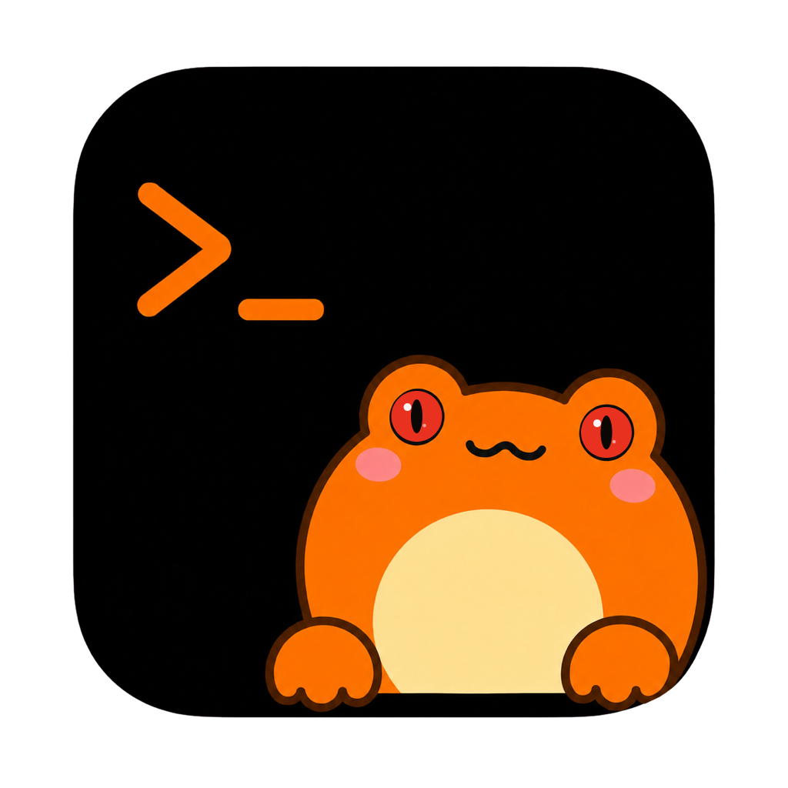
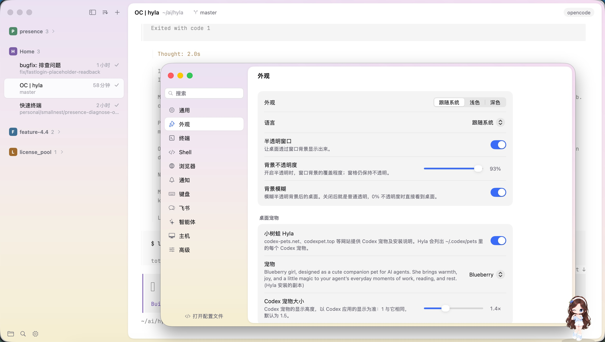

<p align="center">
  
</p>

# Hyla

A terminal for coding agents, on macOS, Windows and Linux.

Run Claude Code, Codex, Pi, OpenCode, a dev server or a test watcher each in
its own session. Hyla groups sessions by project in a sidebar that shows which
are working, which need you and which are done.

Hyla started as a fork of [Kero](https://kero.sh) — `smallnest/kero`, itself a
fork of `egoist/kero` — and has since gone its own way: a name and a look of
its own, and the features below that Kero never had.

<p align="center">
  
</p>

## What it does

- **Sessions outlive the window.** They run in `hylad`, a small daemon, so
  quitting Hyla leaves them running. Reopen it and every pane and its
  scrollback is back.
- **Status at a glance.** Each pane is working, waiting, idle, error or exited.
  <kbd>⌘</kbd> <kbd>J</kbd> jumps to the one that needs you, and Hyla notifies
  you when an agent finishes, fails or is blocked.
- **A tree frog on the window's edge.** Hyla, the red-eyed tree frog, peeks
  over the top of the window: it hops when a session needs you, reads along
  while an agent works, and dozes when all is calm. Press it, or turn it off in
  **Settings › Appearance**.
- **A CLI agents can drive.** `hyla` starts sessions, splits panes, types into
  them, waits on them and reads their screens.
- **Remote hosts.** Run agents on a Linux box, a cloud VM, a Mac, a Windows PC
  or WSL and see them in the same sidebar, over SSH or a Tailcat pair
  code. They keep running when your laptop sleeps. See
  [Remote Hosts](docs/remote.md).
- **Agents in a Feishu chat.** Send the bot a message and the turn runs in a
  Hyla session; the answer comes back as a card, permission requests and
  choices as buttons, and the conversation continues there. The session stays
  in Hyla's sidebar, to watch or take over from the terminal. See
  [Feishu](docs/feishu.md).
- **Ghostty under the hood.** Terminals render with libghostty, so Ghostty
  themes, fonts and config keys just work.

## What this fork adds

The features upstream never took, and what came after the fork went its own
way:

| Feature | What it does |
|---|---|
| **Feishu and Lark** | One Feishu app, one machine's `hylad`: a chat runs an agent's turns in Hyla's own sessions, with cards, permission buttons, choices and transcripts, and a footer of what each turn used. |
| **Tailcat** | Reach a host with a pair code through a relay, with no account on either machine and no port open on its network. Off until you turn it on. |
| **Files view** | A Files tab in the side panel shows the session's folder as a tree, and shows the file you pick, without leaving the window. |
| **Sidebar order** | Group the sidebar by project or by date, or list it flat; order it by creation or last use; give each project a colored badge; and fold its sessions. |
| **Background opacity and blur** | The window's background goes from opaque to translucent to blurred, apart from the panes' own opacity. |
| **Installed fonts** | The font menu lists the monospaced fonts installed on the machine, not a fixed few. |
| **Hyla the frog** | The pet on the window's edge follows your sessions: it hops when one needs you, reads along while an agent works, and dozes when all is calm. |
| **Quitting ends sessions** | Quit and End All Sessions ends this machine's sessions and its `hylad`, while other machines' keep running. |
| **The name and the look** | Hyla was Kero up to 2.1.37: a new name and command, an orange icon with a red-eyed tree frog, and network listeners on 7473 so it can run beside a Kero install. |

## Install

Download Hyla from the [releases page](https://github.com/smallnest/hyla/releases), then choose **Hyla › Install Command Line Tool…** to put `hyla` on your `PATH`.

> **On macOS, the app is not signed with an Apple Developer ID.** The first time you open it, Control-click (or right-click) **Hyla.app** and choose **Open**, then confirm. If macOS still refuses, run:
>
> ```sh
> xattr -d com.apple.quarantine /Applications/Hyla.app
> ```
>
> Apps installed from the earlier `egoist/kero` releases do not update to these releases on their own: install one of these once.

Hyla was called **Kero** up to 2.1.37. Apps of those releases (`smallnest/kero`) do not update to Hyla on their own either: install Hyla once. The first start moves your settings and sessions to `~/.config/hyla` (`~/Library/Application Support/hyla` on macOS), and `KERO_*` environment variables keep working as `HYLA_*`.

```sh
hyla new -n fix-login -- claude
```

To run sessions on a Linux server, a Mac or a Windows PC, install the server build there, then add the machine in **Settings › Hosts**:

```sh
curl -fsSL https://github.com/smallnest/hyla/releases/latest/download/install-server.sh | sh
```

On Windows, in PowerShell:

```powershell
irm https://github.com/smallnest/hyla/releases/latest/download/install-server.ps1 | iex
```

See the [docs](docs/index.md) for more.

## Prior art

- [**Rex**](https://www.superlogical.com/rex/docs/installation): Mitchell Hashimoto's terminal and multiplexer in one native app, with sessions that persist through a server and a scriptable CLI.
- [**Herdr**](https://github.com/herdrdev/herdr): a terminal multiplexer for running many coding agents in one terminal, with agent status detection.

## License

MIT
