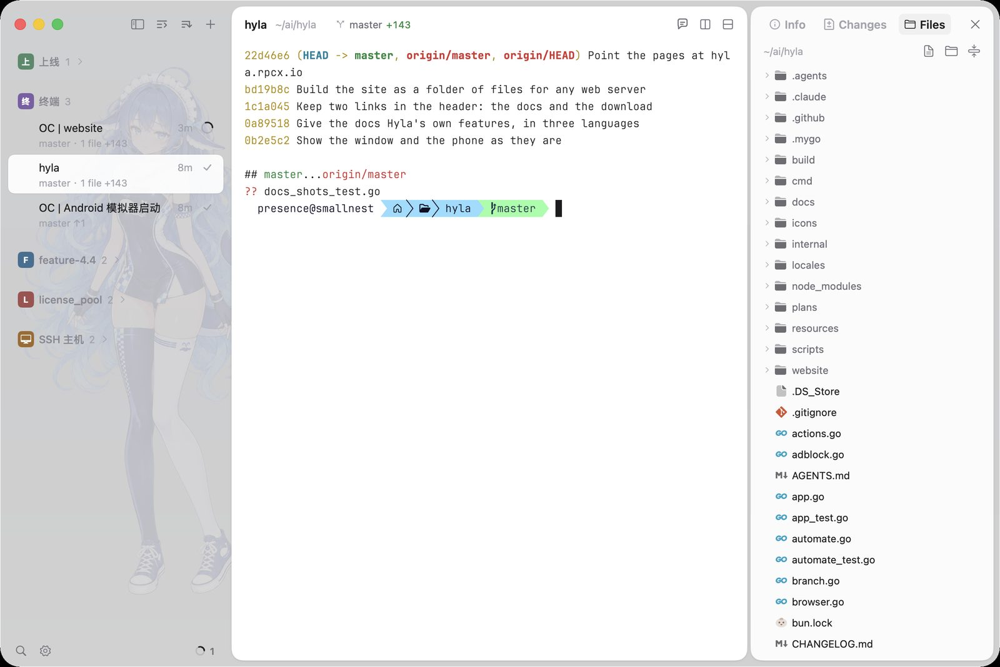
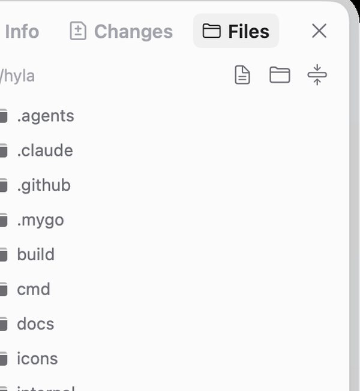

# Files

The side panel has a **Files** view of the folder a session works in, so you can look at a file without leaving the window.

*The Files view in the side panel, on the folder of the selected session.*

## Open it

Choose **View › Toggle Files** (<kbd>⌥</kbd> <kbd>⌘</kbd> <kbd>F</kbd>), or press the Files button in the side panel. The tree follows the selected session: a project's folder, the home folder for a session that started there, or a folder on [another machine](./remote.md).

*Folders unfold where they are; a file shows its type before you open it.*

## Read a file

Click a file to open it in the window. Text shows as text, an image as an image, and a binary file says it is one. Reading never edits anything.

To change it, open your editor from the terminal or let the agent do it, then open the file again.

## Hand a file to a program

Drag a file from the tree into a pane and Hyla types its path there: a shell on this machine gets the path, a pane on another machine gets it [uploaded first](./drops.md).

## What it is not

Not an editor, and not a diff: [Changes](./changes.md) shows what an agent changed, file by file.
