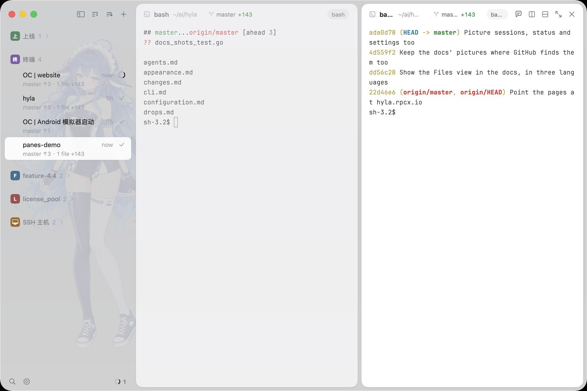

# Panes

Split a session to run things side by side: an agent on the left, its dev server on the right, a test watcher below.

| Action             | Shortcut                                          |
| ------------------ | ------------------------------------------------- |
| Split right        | <kbd>⌘</kbd> <kbd>D</kbd>                         |
| Split down         | <kbd>⌘</kbd> <kbd>⇧</kbd> <kbd>D</kbd>            |
| Zoom pane          | <kbd>⌘</kbd> <kbd>⇧</kbd> <kbd>↩</kbd>            |
| Next / previous pane | <kbd>⌘</kbd> <kbd>]</kbd> / <kbd>[</kbd>        |
| Move between panes | <kbd>⌘</kbd> <kbd>⌥</kbd> <kbd>←</kbd> <kbd>→</kbd> <kbd>↑</kbd> <kbd>↓</kbd> |
| Restart pane       | <kbd>⌘</kbd> <kbd>⇧</kbd> <kbd>R</kbd>            |
| Close pane         | <kbd>⌘</kbd> <kbd>W</kbd>                         |

**Zoom** fills the session with one pane; press it again to bring the others back.

When a pane's program exits, the pane stays so you can read its output. **Restart Pane** starts its shell again in the same directory.



*Two panes of one session, each with its own shell, working in the same folder.*

## From the command line

`hyla split` starts a pane beside another and prints its id:

```sh
hyla split --down -- npm run dev
hyla split --right --ratio 0.3 -- go test ./... -count=1
```

| Flag                                  | Meaning                                        |
| ------------------------------------- | ---------------------------------------------- |
| `--right` (default), `--down`, `--left`, `--up` | Where the new pane goes               |
| `-r`, `--ratio <0..1>`                | The new pane's share of the space (default 0.5) |
| `-d`, `--dir <dir>`                   | Start it in another directory                  |
| `-w`, `--wait`                        | Wait for its command to end, and exit with its status |
| `-u`, `--url <url>`                   | Open a browser showing the page instead of a shell |

Run inside Hyla, `hyla split` splits the pane it runs in. Elsewhere, name a target: `hyla split my-session --down`.

## Browser panes

A browser pane shows a web page beside your terminals: the dev server an agent is working on, the docs it reads, the pull request it opened. It splits, zooms, moves and closes like any pane, and comes back on the same page when Hyla restarts.

| Action           | Shortcut                               |
| ---------------- | -------------------------------------- |
| New browser pane | <kbd>⌘</kbd> <kbd>⇧</kbd> <kbd>B</kbd> |

Type an address in its bar, such as `localhost:3000` or `github.com`, or words to search for. An address typed in the command palette (<kbd>⌘</kbd> <kbd>P</kbd>) opens in a new browser pane too. <kbd>⌘</kbd> <kbd>F</kbd> finds text in the page.

From a shell, or an agent, open one with `--url`:

```sh
hyla split --url localhost:5173
hyla new --url https://github.com/smallnest/hyla/pulls
```

An agent can then use the page as you would, with `hyla browser`: click, type, read its text, wait for it and take a screenshot. See [Command Line](./cli.md#browsing).

```sh
hyla browser type 'input[name=q]' "hyla" --enter
hyla browser text main
```

### Blocking ads

Browser panes block ads and trackers with filter lists, [EasyList](https://easylist.to) and EasyPrivacy unless you choose others. Hyla downloads them the first time a browser pane opens and refreshes them every week. Pages that open before the lists are ready get them as soon as they are, from their next load on.

Choose the lists under **Block ads** in **Settings › Browser**: lists of cookie notices, social buttons, annoyances and Chinese sites' ads are there too. A list of another URL goes in the [configuration](./configuration.md#browser), as `browser-filter-list`. More lists hide more, and now and then break a page.

Hyla blocks what WebKit's content blockers can: requests to ad and tracker servers, and the elements the lists hide. Filters that need a blocker's own scripts, such as those that hide elements by their text or rewrite what a page loads, are left out. A page on a domain the lists block doesn't open in a browser pane.

To browse without blocking, turn off **Block ads** in **Settings › Browser**, or set `browser-block-ads = false` in the [configuration](./configuration.md#browser). Open pages keep what they loaded until they reload.

## Timeline panes

A timeline pane shows what the coding agent in another pane did, turn by turn: each turn with its tools, reasoning and subagents as bars from start to end, a turn that runs reaching now, and the approvals that wait or the tools that failed named under their turn.

| Action             | Shortcut                               |
| ------------------ | -------------------------------------- |
| Open timeline pane | <kbd>⌥</kbd> <kbd>⌘</kbd> <kbd>T</kbd> |

It splits beside the pane you are in and shows that pane's agent, and it stays with that agent: split another timeline beside the agent you want to watch. It splits, zooms, moves and closes like any other pane, and comes back beside its pane when Hyla restarts. Ask for a pane's timeline again and Hyla puts you in the one it made instead of splitting a second.

Hyla reads Claude Code's, Codex's, DeepSeek Harness's and OpenCode's records, beside the agent's conversation. OpenCode keeps its conversations in a database of its own, which Hyla opens read only, so a running agent goes on writing it. A pane that runs no agent Hyla reads says so in place of the turns. The same turns fold into the Info view's Timeline card; `hyla do timeline.window` shows them in a window of its own, for another screen. The agents an agent gave its work to have a [view of their own](./subagents.md).

From a shell, or an agent, `hyla do timeline.open` splits one.

## Subagents panes

A subagents pane shows the agents the session's coding agents gave their work to: which run, what each was asked, how long it has run or has been running, and the step it runs now.

| Action              | Shortcut                               |
| ------------------- | -------------------------------------- |
| Open subagents pane | <kbd>⌥</kbd> <kbd>⌘</kbd> <kbd>S</kbd> |

It splits beside the pane you are in, and it is the session's rather than one pane's: it shows the subagents of every pane's agent. It splits, zooms, moves and closes like any other pane, and comes back when Hyla restarts. Ask for it again and Hyla puts you in the one it made instead of splitting a second.

From a shell, or an agent, `hyla do subagents.open` splits one. The same list is the side panel's [Subagents view](./subagents.md), which is also where the subagents' facts come from.

## The Info view

The side panel shows an Info view of the session's pane. The view shows three sections:

- **Working directory**: the directory the pane works in. Copy the path, show the folder in the file manager, or open the folder in a file pane or in an editor.
- **Process**: the processes that run in the pane's terminal, with their PID, their time and their CPU use.
- **Ports**: the ports that these processes listen on. Click a port to open it in the browser.

When Magpie runs on this machine, the view shows its card last. Magpie is a gateway for coding agents. The card shows:

- Call count, tokens and cost of today.
- The cache hit rate of the input.
- The calls of the session in this pane, when the agent told Hyla its session.
- The plan windows with the least quota left, by provider.
- The latest call: its status, the model that served it and its time.

Hyla reads the gateway on `http://127.0.0.1:3425`. Set `MAGPIE_URL` (or `MAGPIE_PORT`) to use another address. Hyla shows no card when Magpie does not run.

Click the Info tab in the panel's header, or press <kbd>⌥</kbd> <kbd>⌘</kbd> <kbd>I</kbd> (`info.toggle`) to show the view, and press it again to close the panel.

