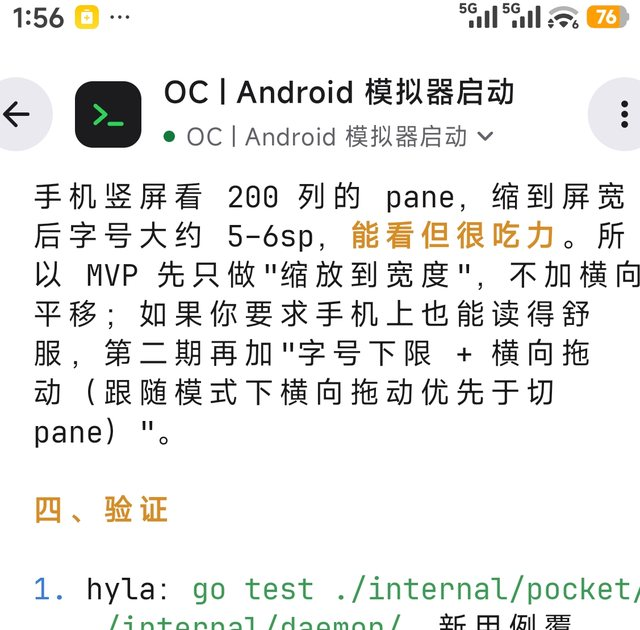

# Hyla Pocket

**HylaPocket** is Hyla's Android client. It shows the sessions running on this machine, in a phone-sized window: the same sessions, the same panes, the same programs.

*The same session, on the phone: HylaPocket reads what the machine's hylad shows.*

## Connect

The phone reaches this machine's `hylad` in one of two ways:

- **A Tailcat pair code.** This machine shows the code in **Settings › Remote**; type or scan it on the phone and the two find each other, without an account and without a relay in the middle when the network allows a direct link. See [Remote Machines](./remote.md#tailcat).
- **An address and a password.** Turn on the network listener in **Settings › Remote**, then give the phone the address it shows, its port and the password. This works on any network the phone can reach, and needs nothing else installed.

The phone and the computer must speak the same protocol: a phone from an older release says so rather than opening sessions it does not understand. Update the APK when the app asks for it.

## What it shows

- **Every session**, live, with the status of each and the panes inside it.
- **The terminal itself**, not a transcript: the program's screen, redrawn as it changes.
- **The key row** under the screen, for what a touch keyboard cannot send: <kbd>esc</kbd>, <kbd>tab</kbd>, <kbd>ctrl</kbd>, <kbd>alt</kbd> and the arrow keys, as modifiers held with a finger.
- **Splits**, so a session with an agent and its tests keeps both on the phone.

Come back to the app and it picks up where you left it: the phone is a window onto the session, not a copy of it, so closing it changes nothing.

## Install

Download the signed APK from its [releases page](https://github.com/smallnest/hyla-pocket/releases/latest) and open it on the phone; Android asks you to allow installing from that source the first time. It needs Android 9 or later.

The client is a separate project: [smallnest/hyla-pocket](https://github.com/smallnest/hyla-pocket).
